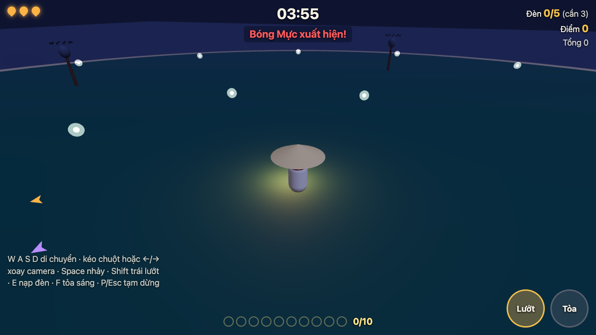
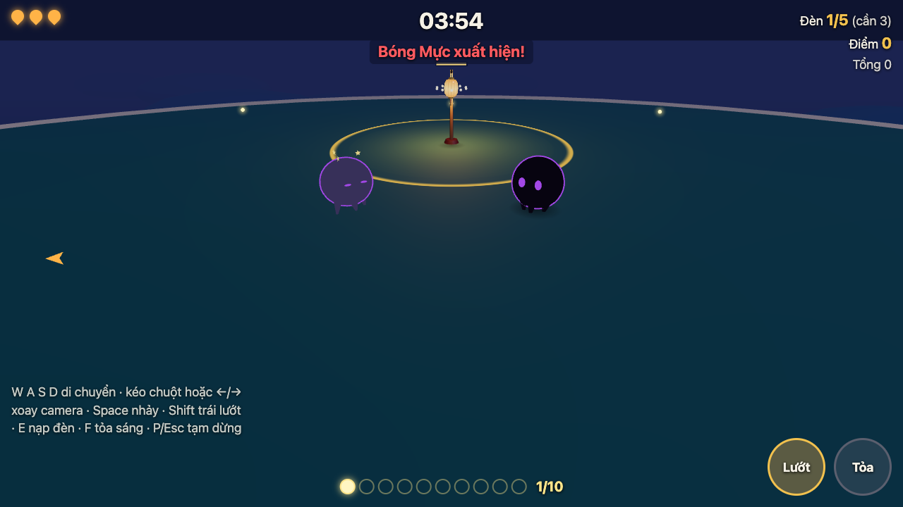
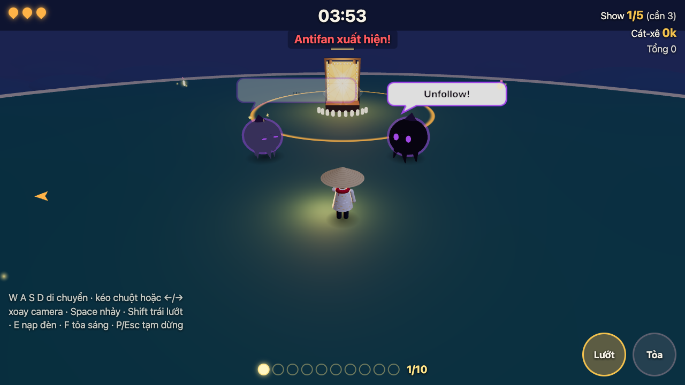

# Đảo Đèn Lồng

**Video demo:** [demo.mp4 (Release v1.0.0)](https://github.com/ToyzZone/K5-L3A-DAY12-NguyenMinhThong-2A202603637-AI-SDLC-Dao-Den-Long/releases/download/v1.0.0/demo.mp4) · **Bản chạy được:** [Release v1.0.0](https://github.com/ToyzZone/K5-L3A-DAY12-NguyenMinhThong-2A202603637-AI-SDLC-Dao-Den-Long/releases/tag/v1.0.0)

Nguyễn Minh Thông, 2A202603637, K5 L3A. Lab cá nhân Day 12 "AI SDLC".

Game 3D góc nhìn thứ ba chạy trong trình duyệt. Mây, người giữ đèn nhỏ tuổi, nhặt Đom đóm, nạp vào các Đèn Lồng Lớn để thắp và giữ dầu cho đèn, dùng Tỏa sáng để xua Bóng Mực, và giữ đảo sáng tới bình minh qua 3 Đêm: Đảo Bến, Đảo Cau, Đảo Chuông.



## Yêu cầu hệ thống

- Node.js ≥ 20. CI chạy Node 20 và 24 trên Linux; máy tác giả chạy Node 24 trên macOS.
- Trình duyệt có WebGL2: Chrome, Edge, Firefox hoặc Safari bản mới.
- Chạy bench cần Chrome, Edge hoặc Chromium. Nếu không tìm thấy, đặt `BENCH_BROWSER=<đường dẫn>`.
- Máy đã thử: MacBook Air M1, 16 GB RAM, macOS.

## Cài đặt và chơi (3 lệnh)

```bash
npm ci
npm run build     # tsc (headless) + vite build (web) vào dist/
npm run play      # = node scripts/play.mjs: mở http://127.0.0.1:5174
```

Với bản Release, chỉ cần Node: tải `dao-den-long-v1.0.0.zip`, giải nén, rồi chạy `node scripts/play.mjs`. Bản Release đã có sẵn `dist/`, không cần `npm`.

## Điều khiển

Mọi phím đổi được trong **Cài đặt → Phím**. Phím trùng sẽ được báo, có nút "Khôi phục mặc định", và thay đổi được lưu lại.

| Mặc định | Việc |
|---|---|
| W A S D | Đi theo hướng camera |
| Kéo chuột, ← → | Xoay camera |
| Space | Nhảy |
| Shift trái | Lướt |
| E | Nạp đèn / châm dầu |
| F | Tỏa sáng (tốn 3 Đom đóm) |
| P hoặc Esc | Tạm dừng (Esc luôn tạm dừng) |

## Hỗ trợ tiếp cận

Tất cả nằm trong **Cài đặt** và được lưu lại.

- **Phụ đề và chỉ báo hình** hiện cho các tình huống sau:
  - Bóng Mực xuất hiện, kèm mũi tên tím ở mép màn hình chỉ tới nó;
  - gió sắp thổi và đang thổi;
  - 10 giây cuối;
  - đèn có dầu < 30;
  - mất Ngọn Lửa;
  - đèn tắt.
- **Giảm chuyển động:** tắt chớp màn hình khi trúng đòn, chớp sáng khi thắp đèn, nhấp nháy của Mây/Bóng Mực/đom đóm, và camera tự xoay ở menu. Game không có rung camera. Mặc định theo cài đặt `prefers-reduced-motion` của hệ điều hành.
- **Cỡ chữ:** mọi chữ UI ≥ 18 px ở 1280×720. Tùy chọn **Chữ lớn** nhân 1.25.
- **Bảng màu dễ phân biệt** (từ Phase 3): Bóng Mực màu xanh lam, đèn tắt có vết rách giấy.

## Bảng xếp hạng

- **Khi nào nhập tên:** sau màn Bình Minh (thắng Đêm 3) hoặc khi thua ở Đêm bất kỳ. Tên dài 3–12 ký tự `A–Z a–z 0–9 _`.
- **Lưu ở đâu:** `leaderboard.json` cạnh `package.json`, nên vẫn còn sau khi tắt game. Đặt `DDL_LEADERBOARD=<file>` để dùng file khác. Khi chạy bằng `npm run dev` (không có server), bảng lưu trong trình duyệt và màn hình có ghi rõ điều này.
- **Xếp hạng:** giữ top 10 theo điểm giảm dần; bằng điểm thì ai đạt trước đứng trên.
- **Xem:** từ menu chính → **Bảng xếp hạng**.
- **Xuất:** `node scripts/play.mjs --export-leaderboard out.json` ghi `{"entries": [...]}` (đây là `run_cmd` trong `game.contract.json`).

## Test, headless, bench, soak

Các lệnh lấy từ `game.contract.json` (contract v1.3).

```bash
npm test                                                     # tsc + 45 test (node:test)
node dist/headless.js --seed 1 --night 1 --ticks 600 --out out.jsonl [--scenario s.json] [--inputs i.json] [--snapshot-every 10]
node scripts/bench.mjs --seed 42 --duration 30 --out bench.json
node --jitless --max-semi-space-size=1 dist/soak.js --seed 7 --nights 10 --out soak.json
```

- **Test:** mỗi tính năng có scenario headless. Có thêm test kiểm tra contract, tất định, soak, cảnh bench và bảng xếp hạng. Bằng chứng từng phase nằm ở [`docs/proof/`](docs/proof/), sinh bằng `scripts/proof.sh <phase>`.
- **Bench:**
  - **Cách chạy:** script dựng server tĩnh không phụ thuộc, mở Chrome/Edge bằng profile tạm ở trang `?bench`, rồi tự thoát với mã 0. Trang dùng cảnh chuẩn của Ticket-04: Đêm 1, đúng 200 Bóng Mực `wander` và 100 đom đóm rải đều theo seed, L1–L3 dầu 100, camera bay vòng 30 m. Canvas cố định 1280×720 với pixel ratio 1.
  - **Vsync:** tắt bằng `--disable-gpu-vsync --disable-frame-rate-limit`. `vsync_off` chỉ ghi `true` khi FPS đo được vượt hẳn 60 Hz (> 75).
  - **`peak_mem_mb` = `null`:** trang web không đọc được RSS của tiến trình trình duyệt; Ticket-04 cho phép điều này với bản web.
- **Soak:**
  - **Cách chạy:** 10 Đêm trong cùng một tiến trình, xoay vòng 1 → 2 → 3. Đêm thứ i (đếm từ 1) dùng seed `7 + i`. Input ngẫu nhiên có RNG riêng. RSS được đo sau khi dọn rác (gc).
  - **Vì sao có cờ:** cờ `--jitless --max-semi-space-size=1` giữ cố định bộ nhớ của chính V8. Với cờ mặc định, `heapUsed` của game gần như không đổi (4.1 → 4.6 MB), nhưng RSS vẫn tăng 14 → 25 MB do trình biên dịch tối ưu của V8 và vùng nhớ trẻ tự nới rộng. Kết quả game y hệt khi chạy có hay không có cờ. Chi tiết: [docs/notes/phase-4.md](docs/notes/phase-4.md).

Số đo trên máy tác giả (bản commit: [`bench.json`](bench.json), [`soak.json`](soak.json)):

| Đo | Kết quả | Ngưỡng |
|---|---|---|
| `avg_fps` | 174.3 | ≥ 60 |
| `p1_low_fps` | 77.5 | ≥ 30 |
| `load_ms` | 2939 | ≤ 10000 |
| Soak `crashes` | 0 | 0 |
| Soak `mem_end_mb` / `mem_start_mb` | 16.4 / 15.1 (1.09×) | ≤ 1.2× |

## Luật và cách tính điểm (contract v1.2/1.3, Ticket-03)

- **Mục tiêu:** giữ đảo sáng tới bình minh. Thắng khi còn sống lúc hết giờ và có ≥ 60% số đèn đang sáng (Đêm 1: 3/5, Đêm 2: 4/6, Đêm 3: 5/7). Hết Ngọn Lửa (Flame) thì thua ngay. Đêm dài 240 / 270 / 300 s.
- **Di chuyển:** chạy 6 m/s, nhảy 7 m/s, Lướt 14 m/s trong 0.2 s (hồi 1.5 s). Rơi khỏi đảo thì −1 Flame.
- **Đom đóm:** tự nhặt khi ở trong 1 m. Sức chứa `10 + 2 × số lần thắp thành công`, tối đa 20.
- **Đèn:**
  - Thắp lần đầu cần 10 Đom đóm, thắp lại cần 5.
  - Đèn vừa thắp có 100 dầu, hao 1/s; hết dầu thì tắt.
  - Bấm E ở đèn đang sáng để châm dầu (+10 mỗi Đom đóm).
  - Đèn có dầu ≥ 30 tạo Vùng an toàn bán kính 6 m.
- **Bóng Mực:**
  - Đuổi khi Mây ở trong 12 m.
  - Khi lang thang thì tìm đèn yếu (dầu < 30) để hút dầu 5/s.
  - Trúng Tỏa sáng thì Choáng 2 s và bị đẩy lùi 4 m.

| Sự kiện | Điểm |
|---|---|
| Mỗi Đom đóm nạp vào đèn | +5 |
| Thắp lần đầu / thắp lại | +100 / +40 |
| Bóng Mực trúng Tỏa sáng (đang hút dầu) | +5 (+15) |
| Khi thắng: mỗi đèn đang sáng | +50 + `floor(dầu)` |
| Khi thắng: mỗi Flame còn lại | +50 |

`tuning` trong `game.contract.json` dùng đúng số chuẩn của Ticket-02/03 (test đỏ nếu lệch). Giả định từng phase: [docs/notes/](docs/notes/). Breaking changes: [CHANGELOG.md](CHANGELOG.md).

## Sáng tạo của tôi

Hai bộ giao diện thêm, chỉ ở phần vẽ ([src/web/skin.ts](src/web/skin.ts), [src/web/themes.ts](src/web/themes.ts)). Sim, Test Contract, bản đồ và đầu ra headless không đổi; `?bench` tắt hẳn theme nên cảnh bench giữ nguyên.

| Theme | Mặc định khi | Đổi gì |
|---|---|---|
| **Sơn Mài** | bản build (`npm run play`) | Mây, Đèn Lồng (đèn lụa bầu dục), Đom đóm và Bóng Mực theo chất liệu tranh sơn mài: mặt bóng, viền thếp vàng |
| **Chạy Show** | `npm run dev` | Mây thành ca sĩ cầm micro (vẫn đội nón lá treo đèn nhỏ), Đom đóm thành fan giơ tim, Đèn Lồng thành sân khấu (khán giả xếp theo tiến độ nạp, đèn rọi khi thắp), Bóng Mực thành antifan có bong bóng chê bai; HUD đổi nhãn thành Show / Cát-xê / Antifan |

- **Đổi theme:** thêm `?theme=sonmai`, `?theme=chayshow` hoặc `?theme=classic` (hình gốc) vào URL.
- **Giữ yêu cầu:**
  - màu các thành phần lấy từ Bảng màu chuẩn Ticket-02 §8;
  - bật "Bảng màu dễ phân biệt" thì theme nhường cho hình gốc (Ticket-03 §6);
  - "Giảm chuyển động" làm phần trang trí đứng yên;
  - theme dùng lại nguồn sáng của game, không thêm đèn.
- **Ba phương án thiết kế** (thêm Giấy Dó, cắt giấy): mở `/preview.html` khi chạy `npm run dev`.
- **Bằng chứng:** hai ảnh dưới chụp game ở Đêm 1, 1280×720, bằng Chrome headless. Tình huống được đặt sẵn bằng công cụ thử: đã thắp 1 đèn, 2 Bóng Mực, 1 con đang Choáng.




## Tài liệu và harness AI

- **Ghi chép:**
  - giả định và đánh giá từng phase: [docs/notes/](docs/notes/);
  - nhật ký dùng AI và token: [ai-log.md](docs/notes/ai-log.md);
  - retro: [retro.md](docs/notes/retro.md).
- **Thuật ngữ và quyết định:** [GLOSSARY.md](GLOSSARY.md), ADR ở [docs/adr/](docs/adr/).
- **Harness:**
  - [CLAUDE.md](CLAUDE.md);
  - skill [`proof`](.claude/skills/proof/SKILL.md);
  - Stop hook trong [`.claude/settings.json`](.claude/settings.json), chặn kết thúc lượt khi test đỏ;
  - CI [`.github/workflows/test.yml`](.github/workflows/test.yml): build như máy chấm, chạy soak, export và test trên Node 20/24.
- **Đề bài gốc:** [docs/lab/](docs/lab/).
- **Nguồn và giấy phép:** [CREDITS.md](CREDITS.md), [LICENSE](LICENSE) (MIT).
